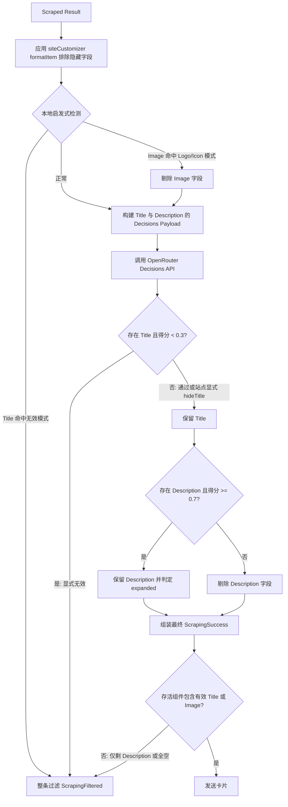

# 链接预览组件级过滤设计 (Link Preview Component-Level Filtering Design)

## 目标与背景 (Intent & Why)

### 问题现状
Sakurako 现存的链接预览过滤机制（`DecisionFilter.ts`）采用**全有或全无（all-or-nothing）**策略：
1. 抓取到的网页元数据（标题、描述、图片）被整体打包为单个 `preview_${index}`，仅向 OpenRouter Decisions API 提问一个综合性的 `has_substantive_info` 问题。
2. 一旦某一项内容质量欠佳（例如视频作者未填写简介，导致 YouTube 的 `og:description` 降级为站点全局宣传词“享受您喜爱的视频和音乐……”），整个预览卡片的综合得分便会被拉低至阈值以下（例如实测得分 `0.278 < 0.7`），进而将整张卡片完全过滤，导致机器人对整条有效链接保持静默。
3. 此外，当前架构在决策前未结合自定义站点规则（`siteCustomizer.formatItem`）。即使某站点显式设置了 `hideDescription: true`（如 GitHub），模型依然在耗费 token 评估描述的增量价值和截断充分性。

### 核心目标
重构链接预览的决策过滤管线，将**整卡粗粒度过滤**演进为**组件级独立决策（Title / Description / Image 分离过滤）**：
- **有效视图预计算**：在决策前先结合自定义站点配置，排除被 `hide*` 标记的字段，杜绝无意义判定。
- **高宽容度标题过滤与级联短路**：标题干扰度极低，默认极高保留率（仅过滤未水合的 SPA 外壳如 "React App"、错误页面如 "404 Not Found"）；若标题判定无效，则触发级联短路，放弃整张预览卡片。
- **描述独立判定与动态展开**：维持现有标准（实质增量性与截断充分性）。若描述被过滤，仅移除描述文本，保留标题与有效图片。
- **图片启发式与内容性判定**：通过本地 URL 关键词启发式快筛通用图标/Logo，再通过模型判定是否为实质内容配图（而非通用占位图/UI 图标）。若图片被过滤，仅剔除图片。
- **部分有效优雅输出**：只要标题或至少一个核心组件存活，即可生成精简卡片回复群聊。

---

## 方案对比 (Approaches Considered)

### 方案 A：有效视图预解析 + 本地启发式初筛 + 模型组件级独立判定（已选定）
- **数据流**：
  1. **有效视图解析**：根据 `findSiteCustomizer(url).formatItem(...)` 得到实际需要展示的字段（尊重 `hideTitle`、`hideDescription`、`hideImage`）。
  2. **本地启发式初筛**：
     - **Title**：正则匹配显式错误/空白/未水合占位词。若命中，直接短路标记整体过滤。
     - **Image**：匹配常见图标/Logo/头像命名特征（`favicon`, `logo`, `avatar`, `chevron` 等），命中则剥离图片。
  3. **模型组件级判定**：针对存活字段分别向 OpenRouter Decisions 提问：
     - `title_is_meaningful`（极高保留度，阈值 `0.3`）；
     - `description_has_substantive_info`（现有阈值 `0.7`）及 `description_is_sufficient`；
     - `image_is_substantive_content`（阈值 `0.5`）。
  4. **级联裁决与组装**：
     - 标题若被模型判定无效，短路丢弃整条预览；
     - 描述/图片若未通过，仅剥离该字段；
     - 存活组件（如“纯标题”或“标题 + 图片”）照常组装输出。
- **优点**：分层明确、开销最小、精准度最高，彻底解决因为单字段缺陷连累整卡的问题。
- **缺点**：Decisions API 的问题数量会根据字段动态增减，需管理更精细的答案映射。

### 方案 B：纯 LLM 单 Prompt 多字段联合判定
- **数据流**：不做任何本地启发式和隐藏字段过滤，将所有字段全部送给 LLM，提问多个问题。
- **未选择原因**：对于明显的 404、React App 或 favicon.ico，白白消耗模型 token 和网络耗时，且在网络超时或模型偶发抖动时缺乏本地保底规则。

### 方案 C：模型仅判定描述，标题与图片 100% 依赖本地启发式
- **数据流**：标题和图片完全由正则表达式和本地黑名单决定，LLM 只判断描述。
- **未选择原因**：本地规则难以穷举各种动态渲染失败的奇怪标题（如多国语言的“正在载入中……”），也无法在没有视觉语义的情况下准确识别非典型样式的通用横幅图片。

---

## 详细架构与技术设计 (Architecture & Design)

### 1. 有效预览元数据提取 (`LinkPreview.ts`)

在向决策模型提交数据之前，结合站点定制逻辑预处理每个结果项：
```ts
export interface EffectivePreviewItem {
  readonly index: number;
  readonly original: PageMetadata;
  readonly title?: string;
  readonly description?: string;
  readonly image?: string;
  readonly fallbackImage?: string;
}
```
- 若 `customizer.formatItem` 返回 `hideTitle: true`，`title` 设为 `undefined`；
- 若 `hideDescription: true`，`description` 设为 `undefined`；
- 若 `hideImage: true` 或图片为 SVG，`image` 与 `fallbackImage` 设为 `undefined`。

### 2. 本地启发式过滤 (`DecisionHeuristics.ts`)

#### 标题无效模式检测 (`isInvalidTitle`)
检测以下模式（大小写不敏感）：
- SPA 占位符：`^(React App|Vite App|Create React App|Loading(\.\.\.)?|加载中(\.\.\.)?)$`
- 错误状态：`^(404( Not Found)?|403( Forbidden)?|500( Internal Server Error)?|Not Found|Error|页面未找到|网页不存在)$`
- 纯空白或长度为 0。

#### 图片通用图标检测 (`isGenericIconUrl`)
对图片 URL 的 pathname 与 query 进行正则匹配：
- 关键词模式：`/(^|[-_./])(logo|favicon|avatar|icon|chevron|arrow|spinner|placeholder)([-_./]|$)/i`
- 若命中，直接将 `effectiveImage` 设为 `undefined`，无需提交给模型评估。

### 3. Decisions 问题与准则设计 (`DecisionFilter.ts`)

针对每个预览项 `key = preview_${index}`，动态构建问题列表：

#### 标题有效性问题 (`${key}_title_is_meaningful`)
- **生成条件**：存在 `title` 且通过了本地启发式初筛。
- **Instructions**：`Evaluate whether \`previews.${key}.title\` is a legitimate, meaningful content title rather than an unhydrated shell, loading placeholder, or generic error message.`
- **Criteria True**：`The title represents real page content, article title, media title, or specific topic, even if short or similar to the URL.`
- **Criteria False**：`The title is a generic site placeholder (e.g. "React App", "Home"), an unhydrated loading state, or an error shell.`
- **阈值**：`0.3`（置信度大于等于 0.3 即算通过，给予极高的保留容忍度）。

#### 描述实质性问题 (`${key}_description_has_substantive_info`)
- **生成条件**：存在 `description`。
- **Instructions / Criteria**：继承现有的增量实质性判定标准（过滤网站宣传语、登录墙、冗余无信息文本）。
- **阈值**：`0.7`（与现有标准保持一致）。
- **充分性问题 (`${key}_standard_is_sufficient`)**：当 `description` 宽度超过 `DEFAULT_DESCRIPTION_MAX_WIDTH` 时追加提问，得分 `< 0.7` 时展开。

### 4. 级联判定与结果合并流程

由于图片采用纯本地启发式快筛（零网络下载开销），模型仅需专注判定 **Title 的有效性** 与 **Description 的实质增量性**：



1. **短路过滤**：若抓取到的标题被本地启发式匹配（404/React App）或模型打分 `< 0.3`（判定为无效占位/错误），视为页面加载失败，级联丢弃整条预览。
2. **站点主动隐藏标题的放行**：若站点定制规则主动设置了 `hideTitle: true`（如 GitHub 单链接预览发送纯卡片图），不触发无效标题短路，允许进入后续判定。
3. **独立字段剔除**：若描述未通过判定，仅将 `description` 剥离（设为 `undefined`）；若图片命中本地通用图标模式，仅剥离 `image`。
4. **卡片有效性底线（锚点原则）**：聊天卡片必须具有明确的主体锚点。预览卡片必须**至少保留有效的 Title 或 Image**；若两者均被过滤（仅剩孤立的 Description），卡片整体过滤，杜绝发送无上下文的孤立引用。
---

## 边界与兼容性考量 (Edge Cases & Invariants)

1. **纯标题预览的展现**：
   对于类似 `https://www.youtube.com/watch?v=AoNnbz237E0` 的案例，标题通过、宣传描述被剔除、高分辨率缩略图通过，机器人将回复：
   ```text
   Bliss (Windows XP)
   [图片: 视频封面]
   ```
   不再因为简介为空而彻底静默。
2. **多链接消息**：
   在包含多条链接的消息中，若某条链接的标题被过滤，该项显示为 `n. [已过滤]`；若描述被过滤，该项只显示序号与标题，不再打印引用的描述行。
3. **Decisions API 降级与兜底**：
   若 OpenRouter 请求失败（超时、500、网络中断），执行 `Effect.catch` 降级，返回经本地启发式过滤后的原始字段（不中断主回复流程）。

---

## 验证计划 (Verification Plan)

### 自动化单元测试
1. **启发式规则测试 (`DecisionHeuristics.test.ts`)**：
   - 验证 `React App`、`404 Not Found`、`Loading...` 准确判定为无效标题。
   - 验证 `Bliss (Windows XP)`、`GitHub - foo/bar` 判定为有效标题。
   - 验证 `https://example.com/assets/logo.png`、`favicon.ico` 准确判定为通用图标。
2. **Decisions 组装与解析测试 (`DecisionFilter.test.ts`)**：
   - 验证 `hideDescription: true` 时不向模型发起描述提问。
   - 验证标题低于 0.3 时级联返回 `Filtered`。
   - 验证描述低于 0.7 时仅清除 `description`，保留 `title`。
   - 验证图片命中通用图标模式或被排除时仅清除 `image`，保留 `title`。
3. **完整集成测试 (`LinkPreview.test.ts`)**：
   - 模拟 YouTube 空描述视频场景，验证返回包含“标题 + 封面图”的预览消息。
