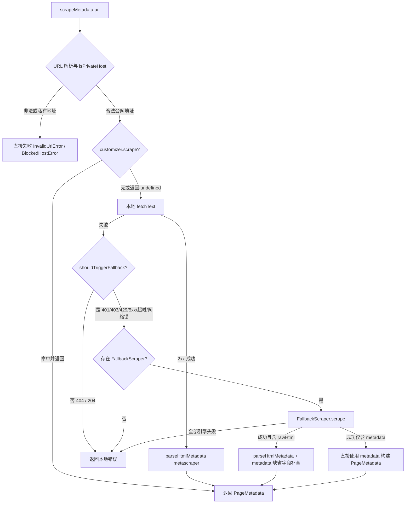

# 链接预览通用抓取回落设计 (Link Preview Scraper Fallback Design)

## 目标与背景 (Intent & Why)

### 问题现状
Sakurako 当前的链接预览（`src/features/link-preview/LinkPreview.ts`）仅由本地 `HttpClient` 直接发起 `GET` 请求抓取网页 HTML。根据线上运行日志观察，许多新闻、技术博客与付费墙站点会对本地请求返回拦截或超时：
- **403 / 401 拦截**：如 `androidauthority.com`、`lwn.net`、`theinformation.com`（`HTTP 403 Forbidden`）及 `reuters.com`、`wsj.com`（`HTTP 401`）。
- **本地网络超时**：如 `ithome.com`（`Request timed out after 10 seconds`）。

上述情况会导致本可正常展示摘要的链接直接失败静默。

### 核心目标
1. **自动抓取回落**：当本地抓取因拦截、限流、服务端异常、超时或网络错误失败时，自动通过远程抓取引擎重新获取页面内容并继续走现有的 `metascraper` + 决策过滤管线。
2. **引擎无关抽象**：回落层以通用的 `FallbackScraper` 服务与 `ScraperEngine` 接口建模，按优先级支持多引擎顺序回落，首个内置引擎对接 Firecrawl `/v2/scrape`，后续可无痛扩展其他抓取引擎。
3. **默认开箱即用**：在未配置 `FIRECRAWL_API_KEY` 时默认使用 Firecrawl 免 Key 模式；配置后自动附带 Bearer Token 鉴权以获取更高额度。
4. **安全与语义不退化**：SSRF 私有地址拦截必须在回落前生效，绝不将内网地址发往外部引擎；`404`/`204` 等明确资源缺失状态不触发回落；回落失败时保留原始本地错误。

### 非目标 (Non-Goals)
- 不对通用 `HttpClient`（如图片下载、SauceNao、Danbooru API 请求）做透明代理替换。
- 不在本期引入多引擎动态权重调度或持久化配额统计（仅按配置顺序依次尝试）。
- 不尝试绕过需要用户登录态的 Cookie 认证。

---

## 方案对比 (Approaches Considered)

### 方案 A：链接预览层的通用抓取回落服务（已选定）
- **结构**：在 `src/features/link-preview/FallbackScraper.ts` 定义 `FallbackScraper` 服务（`Context.Service`）与 `ScraperEngine` 引擎接口，内部维护有序引擎链（目前内置 Firecrawl `/v2/scrape` 引擎）。`LinkPreview.ts` 的 `scrapeMetadata` 在本地 `fetchText` 出现可恢复拦截/网络错误时调用 `FallbackScraper.scrape(url)`。
- **优点**：职责边界清晰；引擎输出同时支持 `rawHtml`（复用全部分站 `metascraper` 规则）和结构化 `metadata` 兜底；不影响图片下载与其他业务接口。
- **缺点**：图片下载遇到 429/403 时暂不复用该机制（需单独设计媒体代理，不属于本次范围）。

### 方案 B：下沉至 `src/utils/HttpClient.ts` 的通用请求回落
- **未选择原因**：远程抓取引擎输入为目标 URL、输出为 JSON 包装的 `rawHtml` 与页面元数据，与通用 HTTP 层的原始字节流、状态码和 API 响应体语义不匹配；强行耦合会导致后续接入只返回摘要文本或特定结构化字段的引擎时接口变形。

### 方案 C：基于 `LinkPreviewSites.ts` 的域名白名单回落
- **未选择原因**：需要人工持续维护被拦截域名列表，无法自动应对日志中随时出现的新站点拦截与偶发本地网络超时。

---

## 详细架构与技术设计 (Architecture & Design)

### 1. 配置扩展 (`src/Config.ts`)

在 `BotConfig` 中增加可选的引擎密钥配置：
```ts
export interface BotConfig {
  // ...现有字段
  readonly firecrawlApiKey?: Redacted.Redacted<string>;
}
```
对应环境变量：
- `FIRECRAWL_API_KEY`：可选，`Config.option(Config.Redacted("FIRECRAWL_API_KEY"))` 解析。未配置时 Firecrawl 引擎仍以**免 Key 模式**启用；配置后请求头附带 `Authorization: Bearer <token>`。

### 2. 通用回落服务与引擎接口 (`src/features/link-preview/FallbackScraper.ts`)

#### 核心类型与错误
- **`FallbackMetadata`**：
  ```ts
  export interface FallbackMetadata {
    readonly title?: string;
    readonly description?: string;
    readonly image?: string;
  }
  ```
- **`FallbackScrapeResult`**：
  ```ts
  export interface FallbackScrapeResult {
    readonly engineId: string;
    readonly url: string;
    readonly html?: string;
    readonly metadata?: FallbackMetadata;
  }
  ```
- **`ScraperEngine`**：
  ```ts
  export interface ScraperEngine {
    readonly id: string;
    readonly scrape: (
      url: string,
    ) => Effect.Effect<FallbackScrapeResult, FallbackScrapeError>;
  }
  ```
- **`FallbackScrapeError`**：继承 `Schema.TaggedError`（遵循仓库 `{ readonly brand: unique symbol }` 规范），记录 `engineId`、`url`、`reason` 与可选 `status`。

#### `FallbackScraper` 服务
- 定义为 `Context.Service`（服务标识 `"sakurako/link-preview/FallbackScraper"`），暴露：
  - `scrape(url: string): Effect.Effect<FallbackScrapeResult, FallbackScrapeError>`
- 执行逻辑：
  - 通过并发信号量（`concurrency = 2`）限制同时在途的远程回落请求数，避免 `scrapeAll` 在多链接消息中无界并发触发 Firecrawl Free/免 Key 套餐的 2 并发浏览器上限（`429`）；
  - 按 `engines` 顺序逐个尝试 `engine.scrape(url)`；
  - 某个引擎失败时记录 `Effect.logWarning`（包含 `engine.id`、`url` 与失败原因），继续尝试下一个引擎；
  - 首个成功引擎即返回结果；
  - 若所有引擎均失败（或引擎列表为空），返回最后一个（或汇总的）`FallbackScrapeError`。
- 工厂与 Layer：
  - `FallbackScraper.fromEngines(engines: ReadonlyArray<ScraperEngine>)`：构建可测试的服务实例与 `Layer.succeed`，方便单元测试验证多引擎顺序回落、并发限制与错误隔离。
  - `FallbackScraper.layer`：`Layer.effect`，注入 `HttpClient.HttpClient` 与可选 `BotConfig`（`Effect.option(BotConfig)`），构造默认引擎列表 `[createFirecrawlEngine(httpClient, firecrawlApiKey)]`。

### 3. Firecrawl 引擎实现（`FallbackScraper.ts` 内部适配器）

- **请求构造**：
  - `POST https://api.firecrawl.dev/v2/scrape`
  - 请求头：`Content-Type: application/json`、`Accept: application/json`；若配置了 `firecrawlApiKey`，附加 `Authorization: Bearer ${Redacted.value(firecrawlApiKey)}`。
  - 请求体：`{ url, formats: ["rawHtml"], timeout: 25000 }`。
  - 超时对齐：服务端请求体 `timeout: 25000`（25 秒）严格小于本地 `fetchJson` 的 `timeoutDuration: "30 seconds"`，确保服务端超时能先于本地取消返回结构化响应，同时为队列等待与无头浏览器渲染预留足够时间。
  - 限流策略：引擎请求遇到 429 或超时时快速失败（不做本地指数退避重试），将控制权交回 `FallbackScraper` 尝试下一个引擎或结束回落。
  - 通过 `Schema` 校验外层 `success: boolean`、`error`、`code` 与 `data`（含 `rawHtml` 与 `metadata`）。
  - **关键校验**：即使 `success === true`，也必须检查 `data.metadata?.statusCode`；若存在且不在 `200..299` 范围内（如目标站仍返回 403/404/5xx），判定该次引擎抓取失败并抛出 `FallbackScrapeError`。
  - 目标最终 URL 取 `data.metadata?.url ?? data.metadata?.sourceURL ?? url`。
  - 提取 `rawHtml`（非空字符串）与结构化 `metadata` 兜底字段（`ogTitle ?? title`、`ogDescription ?? description`、`ogImage`，若 Firecrawl 返回字符串数组则取首项非空值）。
  - 若 `rawHtml` 与结构化 `metadata`（至少 title/description/image 之一）均为空，判定失败并抛出 `FallbackScrapeError`。

### 4. 与 `LinkPreview.ts` 集成流程



#### 触发条件判定 (`shouldTriggerFallback`)
针对 `ScrapeMetadataError` 中的本地请求错误：
- **触发回落**：
  - `HttpRateLimitError`（429）
  - `HttpTimeoutError`（超时，如 `ithome.com` 10s 超时）
  - `HttpNetworkError`（覆盖 401、403、5xx、连接中断、TLS/DNS 等异常）
- **不触发回落**：
  - `InvalidUrlError`、`BlockedHostError`（SSRF 与参数合法性前置校验）
  - `HttpNotFoundError`（404）、`HttpNoContentError`（204）
  - `ParseMetadataError`（本地已成功拉取 HTML，解析异常无需远程重抓）

#### 元数据解析与合并细节
- 将现有 `scraper({ html, url: targetUrl })` 与 SVG 图片过滤逻辑抽取为共享辅助函数 `parseHtmlMetadata(originalUrl, html, targetUrl)`。
- 当回落引擎返回 `html`（`rawHtml`）时，走 `parseHtmlMetadata` 以完整保留 `LinkPreviewSites.ts`（如 Hacker News `.titleline`、Pixiv `fallbackImage`）与 `firstParagraphPlugin` 的提取能力；若解析后仍缺失 `title`/`description`/`image`，使用引擎返回的 `metadata` 对应字段补全（`image` 仍过滤 SVG）。
- 若某未来引擎仅返回 `metadata` 而无 `html`，直接使用其 `metadata` 组装 `PageMetadata`（`image` 过滤 SVG）。
- 返回的 `PageMetadata.url` 始终保持为原始 `url`。
- 若 `FallbackScraper` 所有引擎均失败，记录告警并**抛出原始本地错误**（不以远程引擎报错掩盖真实目标站状态）。

### 5. 入口与启动日志 (`src/index.ts`)

- 构建 `FallbackScraperLive = FallbackScraper.layer.pipe(Layer.provide(FetchHttpClient.layer))` 并合入 `MainLive`。
- `LinkPreview.ts` 通过 `Effect.option(FallbackScraper)` 获取服务，确保生产环境通过 `MainLive` 强制启用，同时保持现有仅注入 `HttpClient` 的隔离单元测试行为不受破坏。
- 在 `logStartupInfo` 中输出抓取回落状态日志（区分已配置 Firecrawl API Key 与免 Key 模式）。

---

## 边界与兼容性考量 (Edge Cases & Invariants)

1. **SSRF 边界**：`isPrivateHost` 在 `customizer?.scrape`、本地 `fetchText` 和 `FallbackScraper` 之前执行；内网/回环 URL 绝不会发送到远程抓取引擎。
2. **自定义站点回落**：`danbooruCustomizer.scrape` 当前已捕获 `HttpNoContentError | HttpRateLimitError | HttpTimeoutError | HttpNetworkError` 并返回 `undefined`，随后自动进入 `fetchText` 并命中通用回落，无需在分站规则内重复编写回落逻辑。
3. **Firecrawl 假成功防护**：Target site 返回 403/404 时 Firecrawl API 外层 HTTP 状态码仍为 200 且 `success: true`，必须依赖 `data.metadata.statusCode`（仅放行 2xx）防止将拦截页或错误页当成正常网页解析。
4. **原始错误保真**：回落失败时对外暴露原始 `localError`，确保多链接列表中的 `[提取失败：...]` 提示及既有 `scrapeAll` 失败测试契约保持一致。

---

## 验证计划 (Verification Plan)

1. **单元测试 (`test/features/link-preview/FallbackScraper.test.ts`)**：
   - 验证 Firecrawl 引擎在未配置 Key（无 Authorization 头）和配置 Key（带 Bearer 头）下的请求体与请求头格式。
   - 验证 `statusCode >= 400` 或 `success: false` 或空内容时正确拒绝。
   - 验证多引擎链在首个引擎失败时自动回落到第二个引擎，全部失败时返回失败。
2. **集成与边界测试 (`test/features/link-preview/LinkPreviewEngine.test.ts` & `LinkPreviewBot.test.ts`)**：
   - 验证 `403`、`401`、`429`、超时触发回落并成功提取 `rawHtml` 元数据（含 `firstParagraphPlugin` / `LinkPreviewSites` 规则）。
   - 验证 `404`、`BlockedHostError` 不触发回落请求。
   - 验证回落引擎失败时保留原始本地错误（如 `HttpNetworkError` 403）。
   - 验证端到端 `handleLinkPreviewMessage` 在本地返回 403 + 回落返回有效页面时正确发出预览回复。
3. **配置与日志测试 (`test/Config.test.ts` & `test/StartupLog.test.ts`)**：
   - 验证 `FIRECRAWL_API_KEY` 可选解析与启动日志输出。
4. **实测冒烟验证（Bun + Effect `FetchHttpClient`）**：
   - 使用真实 Bun 运行时与 `FetchHttpClient.layer` 对 `run-2.log` 中的真实 403/401 链接（如 `androidauthority.com`、`lwn.net`）跑一次免 Key 端到端抓取与预览格式化验证，确认不依赖 `curl` 特定请求头也能正常通行。
